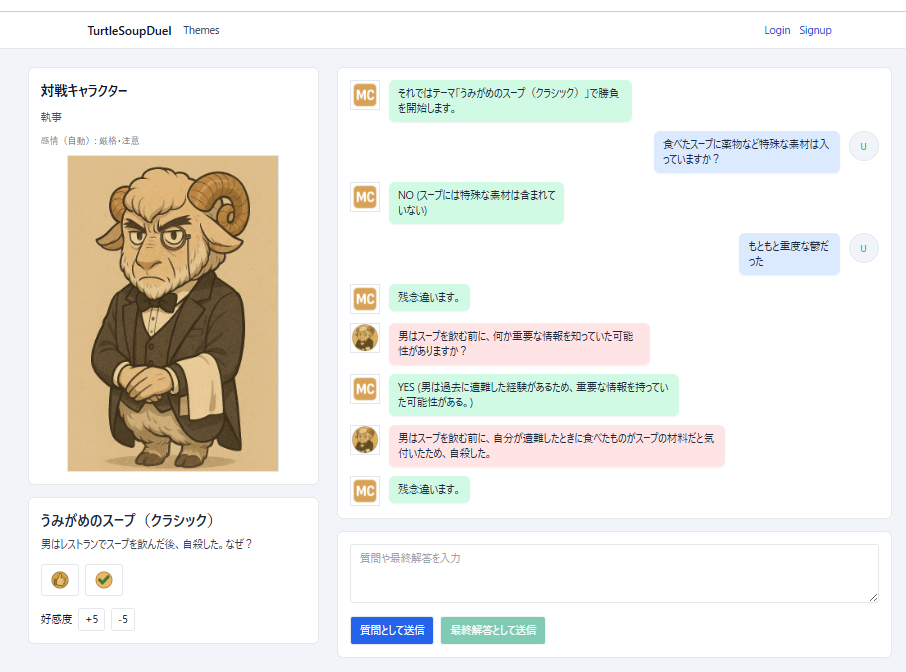

# TurtleSoupDuel (v0.1)

水平思考クイズ「うみがめのスープ」をAI進行役＋AI対戦者で動かすAPIとフロント（Next.js）を含む構成。

本作の対戦ルールは「質問→回答」を1セットとして交互に進行します（ユーザーの質問→MCの判定→AIの質問→MCの判定…）。



## セットアップ

- 必要: Python 3.10+ / Node.js 18+ / Cassandra
- 推奨: 依存は `requirements.txt` / `web/package.json` を使用

```
# 仮想環境（任意）
python -m venv .venv && source .venv/bin/activate

# 依存
pip install -r requirements.txt
```

```
# フロント依存
cd web
npm install
cd ..
```

## DB（Cassandra）

- DBは必須です。未接続だと `/api/v1/themes` 系は 503 になります。
- マイグレーション: `web/db/migrations/*.cql` を順に適用。

例（ローカルの Cassandra へ適用する場合）:
```
# 例: cqlsh が利用できる前提
cqlsh -e "CREATE KEYSPACE IF NOT EXISTS turtlesoup WITH replication = {'class': 'SimpleStrategy', 'replication_factor': 1};"
for f in web/db/migrations/*.cql; do cqlsh -f "$f"; done
```

### テーマデータ投入

以下のどちらかを利用:
- `cd web && npm run db:import-themes`（`web/scripts/import_theme_json.js`）
- `python app/bulk_theme_loader.py <input.json>`（JSON/NDJSON対応）
```

## 起動

```
# FastAPI
uvicorn app.main:app --reload --port 8000

# Next.js
cd web
npm run dev
cd ..
```

- フロント: http://localhost:3000/
- API: http://localhost:8000/api/v1

## 環境変数

### FastAPI（`.env` で自動読込）

```
PORT=8000
MC_PROVIDER=openai
MC_MODEL=gpt-4o-mini
AI_PROVIDER=openai
AI_MODEL=gpt-4o-mini
THEME_DIR=./themes
CASSANDRA_CONTACT_POINTS=127.0.0.1:9042
CASSANDRA_KEYSPACE=turtlesoup
CASSANDRA_DC=dc1
CASSANDRA_USER=...
CASSANDRA_PASS=...
CASSANDRA_TIMEOUT=5
OPENAI_API_KEY=sk-...
```

- `.env`自動ロード: サーバ起動時にカレントの`.env`を自動読込（`python-dotenv`）。`.env`が無い場合はOSの環境変数を使用します。

### Next.js（`web/.env.local`）
```
CASSANDRA_CONTACT_POINTS=127.0.0.1:9042
CASSANDRA_KEYSPACE=turtlesoup
CASSANDRA_DC=dc1
CASSANDRA_USER=...
CASSANDRA_PASS=...
```

## 主要エンドポイント

- GET `/api/v1/themes`
- GET `/api/v1/themes/{id}`
- POST `/api/v1/game/start` `{ theme_id, ai_model }`
- POST `/api/v1/game/user/question` `{ text | pass }`
- POST `/api/v1/game/user/guess` `{ text | pass }`
- POST `/api/v1/game/ai/question`
- POST `/api/v1/game/ai/guess`
- POST `/api/v1/game/next`
- GET `/api/v1/game/state`

## 実装メモ

- v0.1はメモリ管理・単一ゲームのみ。
- LLMはネットワーク不要の`MockLLMProvider`で動作（`app/providers/mock.py`）。
- テーマは Cassandra の `themes_by_id` テーブルを使用。
